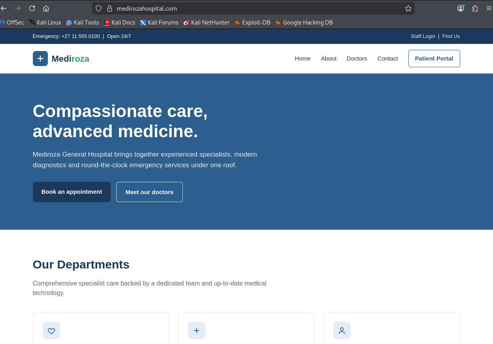
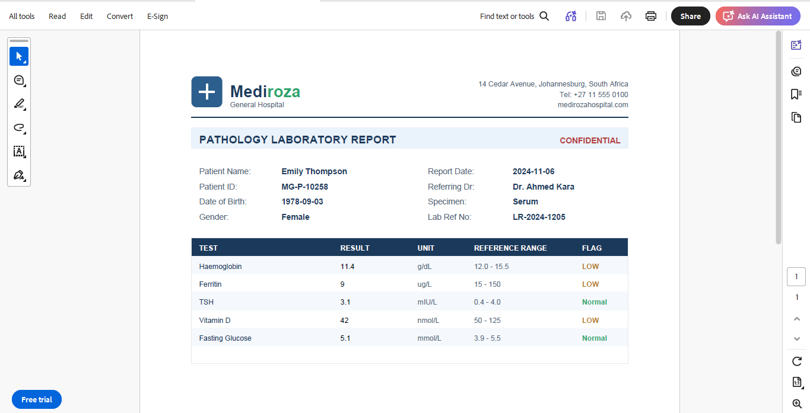
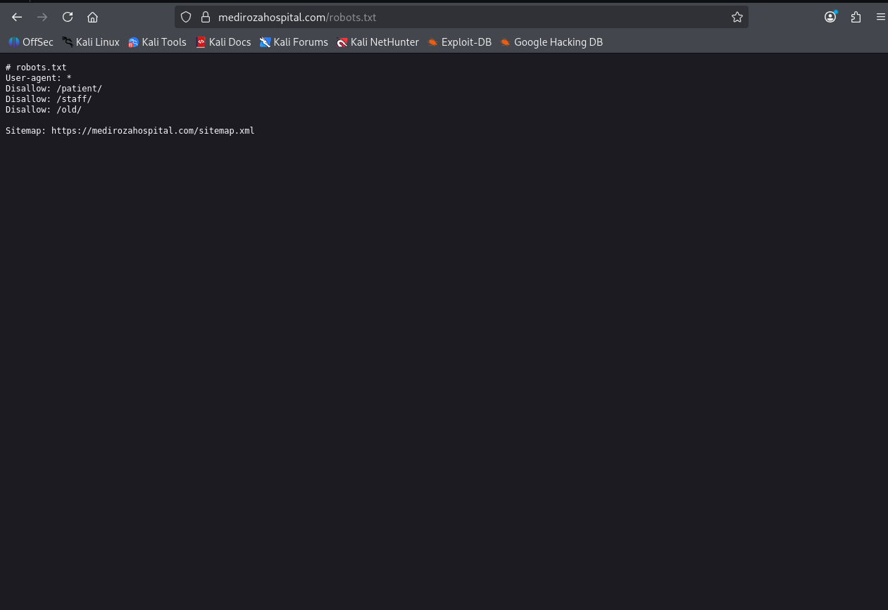
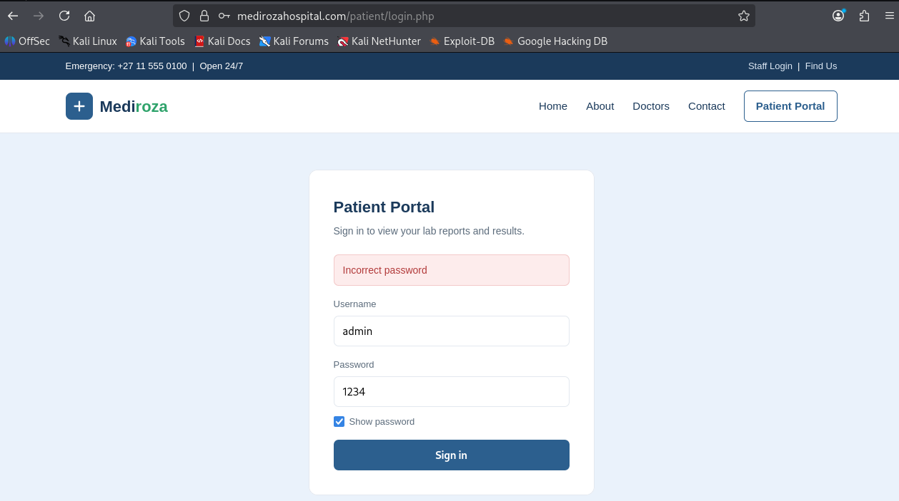
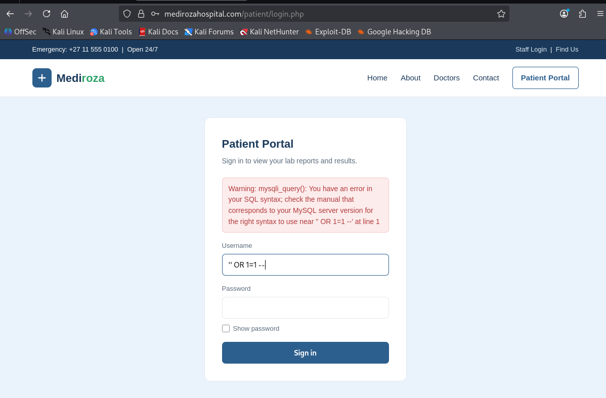
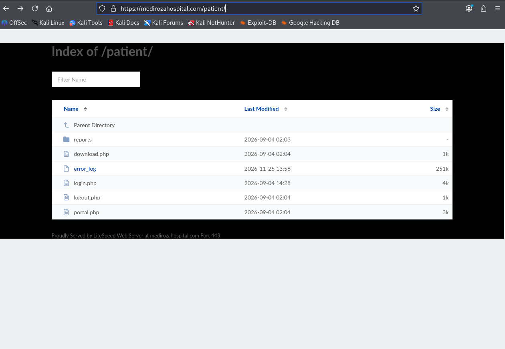
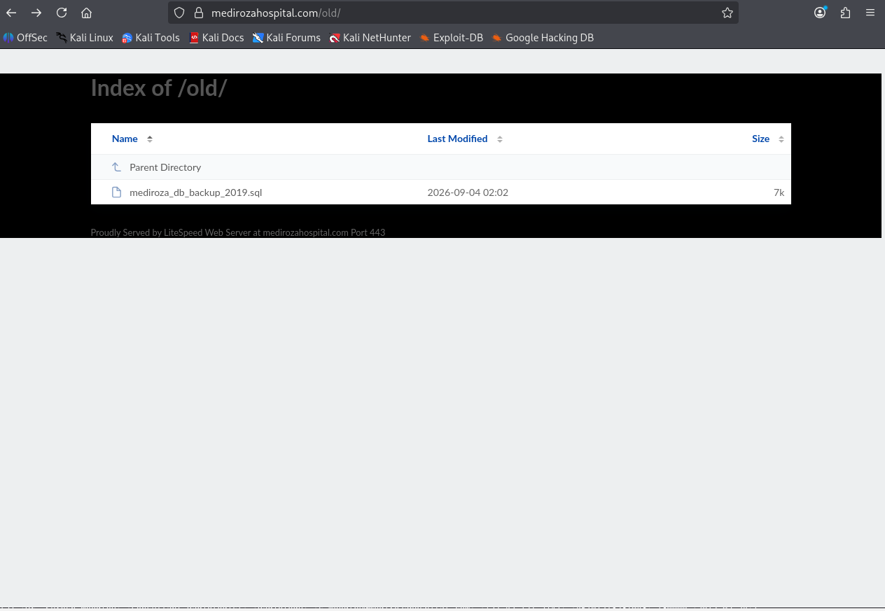
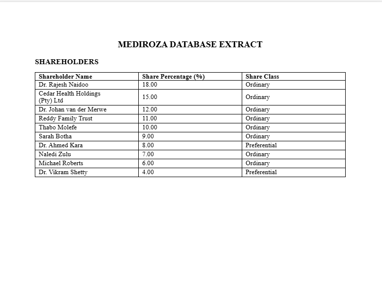
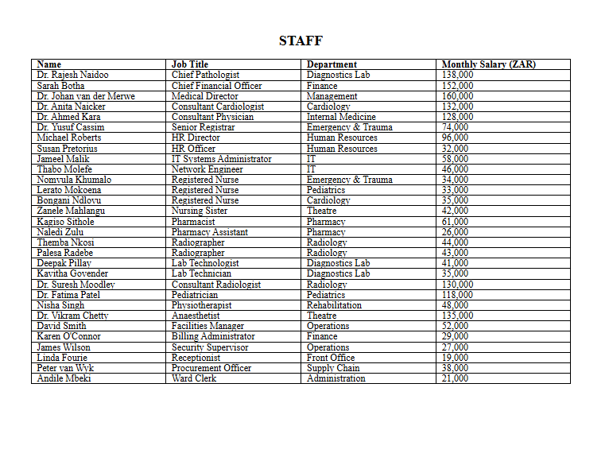

 Mediroza Hospital — Web Application Penetration Test
=======================================================

### A full black-box penetration test of a hospital patient portal, from `robots.txt` to a leaked payroll database.


---

###  Project Overview

This project is a **black-box web application penetration test** carried out against `medirozahospital.com`, a simulated hospital patient portal, as my **Week 4 Capstone Project** for the **NetworkWalks Cybersecurity Internship (Batch B084)**.

The goal was to start with nothing but a URL and legitimate written authorization, and see how far an unauthenticated attacker could get using only free tools, patience, and well-known vulnerability classes.

By the end of the engagement I had chained **10 separate findings** — from a leaky `robots.txt` file all the way through SQL injection, weak PDF encryption, and careless metadata — into full, unauthenticated access to:

-  Three confidential patient pathology lab reports
-  The monthly salaries and national ID numbers of all 30 hospital staff
- The full shareholding structure of the hospital's 10 shareholders

All testing was performed in an isolated virtual lab against a target explicitly set up for this exercise, with written authorization from the client. **No real patient, staff, or financial data was involved.**

---

###  Objective

> Identify vulnerabilities in the Mediroza patient portal, demonstrate their real-world impact through controlled exploitation, and deliver a professional report with practical remediation guidance.

---

###  Scope

| | |
|---|---|
| **Target** | `https://medirozahospital.com` |
| **Testing type** | Black-box, unauthenticated |
| **In scope** | Patient portal, staff portal, publicly reachable paths |
| **Out of scope** | Social engineering, denial-of-service, anything off-domain |

---

### Tools Used


- **Browser & DevTools** — manual recon, directory enumeration, login form testing
- **Networkwalks Hash Calculator** — extracting crackable hashes from encrypted PDFs
- **Networkwalks Password Cracker** — dictionary attacks against PDF password hashes
- **qpdf** — decrypting PDFs once a password was recovered
- **exiftool** — pulling hidden metadata out of PDF files

---

###  Findings Summary

| # | Vulnerability | Location | Risk |
|---|---|---|---|
| 1 | Information disclosure via `robots.txt` | `/robots.txt` | 🟢 Low |
| 2 | Username enumeration on login page | `patient/login.php` | 🟡 Medium |
| 3 | **SQL injection — authentication bypass** | `patient/login.php` | 🔴 Critical |
| 4 | Directory listing enabled | `patient/` | 🟠 High |
| 5 | Directory listing enabled | `staff/` | 🟡 Medium |
| 6 | Confidential encrypted PDFs accessible | `patient/reports/` | 🟠 High |
| 7 | Weak PDF passwords crackable with a wordlist | `patient_report_*.pdf` | 🟠 High |
| 8 | Sensitive metadata left in PDF file | `patient_report_3.pdf` | 🟡 Medium |
| 9 | Forgotten backup folder, directory listing on | `old/` | 🔴 Critical |
| 10 | **Staff salaries & shareholder data in plain text** | `old/mediroza_db_backup_2019.sql` | 🔴 Critical |

---

### Spotlight: The SQL Injection

The login form's username field was concatenated directly into a SQL query with no sanitization. Submitting a single quote broke the query and leaked a raw MySQL error:

```
Warning: mysqli_query(): You have an error in your SQL syntax; check the manual
that corresponds to your MySQL server version for the right syntax to use near
''' at line 1
```

Confirming the field was injectable, I submitted the classic bypass payload as the username:

```
Username: admin' --
Password: password123   (anything works here)
```

The `--` comments out the rest of the query, so the password check is never evaluated:

```sql
-- Before injection
SELECT * FROM users WHERE username='<input>' AND password='<input>'

-- After injection
SELECT * FROM users WHERE username='admin'
```

Result: **full authentication bypass**, logged in as `admin`, zero valid credentials required.

---

###  Spotlight: The Exposed Database Backup

A hidden `Comments` field inside one of the cracked PDFs — left behind by an IT administrator — read:

> *"DB backup moved to /old before site migration, do not delete"*
> — Author: `j.malik`

Following that single breadcrumb straight to `/old/`, directory listing was enabled and `mediroza_db_backup_2019.sql` sat there with **no authentication required**. Inside: plain-text names, national ID numbers, phone numbers, and monthly salaries for all 30 staff, plus the hospital's full shareholder register — and `j.malik` turned out to be **Jameel Malik, the IT Systems Administrator himself**, tying the whole chain together.

---

###  Key Recommendations

| Fix | Why it matters |
|---|---|
| Use parameterized queries / prepared statements | Closes the SQL injection entirely — the #1 priority |
| Generic login error messages | Stops username enumeration |
| `Options -Indexes` in Apache config | Kills directory listing on all exposed folders |
| Move PDFs outside the web root + enforce auth server-side | Stops direct, unauthenticated file access |
| Strip metadata before distributing PDFs (`exiftool -all=`) | Internal notes should never leave the organization |
| Store backups outside the web root, access-controlled | A backup should never be one URL away from the public internet |

---
## All Evidence of images and the technical work done is shown below
## 
## 
## 
## 
## 
## 
## 
## 
## 
## 


# This URL shows all the full Technical steps and Evidence 
https://github.com/Richwhyte/NETWORKWALKS-WEEK4-Mediroza-Hospital-Web-Application-Penetration-Test-B084-/commit/f1a3b8f8c1a82831110219f4a5541894cf941edb#diff-6aec01df240edb87cda16b7ab721766d3fce0c56f46240c27281848af8e1682b

###  Full Report

The complete penetration testing report — with every finding, full evidence screenshots, the full attack chain, and detailed remediation guidance — is included in this repository:

📎 **[`Okon_Inemesit_Udo_Penetration_Testing_Report.pdf`](Okon_Inemesit_Udo_Penetration_Testing_Report.pdf)**

---

###  Disclaimer

This project was carried out as a **controlled educational exercise** under the NetworkWalks Cybersecurity Internship Program against a **simulated training environment**, with written authorization from the client. These techniques must never be applied to any system without explicit written permission from its owner.

---

### 👤 Author


**OKON Inemesit Udo**
Week 4 Capstone Project · NetworkWalks Cybersecurity Internship · Batch B084
